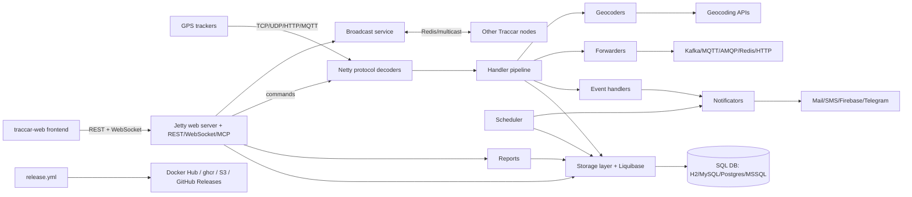

# Architecture

Traccar is one Java process. It listens on one port per device protocol, decodes what trackers send, runs each position through a handler chain, stores it in an SQL database and serves a REST/WebSocket API on port 8082.

All Java code is under `src/main/java/org/traccar/`. Paths below are relative to that folder unless they start at the repository root.

## Startup

`Main.java` reads the config file (argument, or `./debug.xml` by default), builds a Guice injector from `MainModule`, `storage/DatabaseModule` and `web/WebModule`, then starts four services in order: `schedule/ScheduleManager`, `ServerManager`, `web/WebServer`, `broadcast/BroadcastService`. Configuration keys and their defaults are all declared in `config/Keys.java`; `config/Config.java` reads the XML file and, when enabled, environment variables.

## Protocol layer

- `ServerManager.java` reads the protocol list from `config/ProtocolConfig.java` (class and default port per protocol, from 5001 up), keeps the `tc_protocols` table in sync and starts one `TrackerServer` per protocol.
- `TrackerServer.java`, `BasePipelineFactory.java`, `PipelineBuilder.java`: Netty pipelines. Each `protocol/<Name>Protocol.java` adds its frame decoder, encoder and decoder in `addProtocolHandlers`.
- `protocol/` holds about 680 files: `*Protocol`, `*FrameDecoder`, `*ProtocolDecoder`, `*ProtocolEncoder`. Shared bases: `BaseProtocolDecoder`, `BaseFrameDecoder`, `BaseHttpProtocolDecoder`, `BaseMqttProtocolDecoder`, `BaseProtocolEncoder`. Shared helpers in `helper/` (`Parser`, `PatternBuilder`, `BitUtil`, `Checksum`, `UnitsConverter`).
- Tech: Netty 4.2.

## Processing pipeline

`ProcessingHandler.java` runs each decoded `model/Position` through the position handlers in `handler/` (filter, time, distance, motion, engine hours, geocoder, geolocation, geofence, speed limit, computed attributes, driver, copy attributes) and then the event handlers in `handler/events/` (alarms, overspeed, ignition, geofence, motion, maintenance, fuel, driver, behavior). `database/PositionBatchWriter.java` can write positions in batches. Positions also go to `handler/PositionForwardingHandler.java` for forwarders.

## Storage

- `storage/Storage.java` is the interface; `storage/DatabaseStorage.java` builds SQL with `QueryBuilder` over HikariCP; `storage/MemoryStorage.java` is an in-memory implementation.
- Model classes in `model/` map to tables with `@StorageName`: `tc_users`, `tc_devices`, `tc_positions`, `tc_events`, `tc_groups`, `tc_geofences`, `tc_notifications`, `tc_commands`, `tc_commands_queue`, `tc_drivers`, `tc_calendars`, `tc_attributes`, `tc_maintenances`, `tc_reports`, `tc_orders`, `tc_actions`, `tc_statistics`, `tc_servers` (one row of global settings), `tc_protocols`, `tc_revoked_tokens`, plus link tables such as `tc_device_device`.
- Schema: Liquibase changelogs in `schema/` (repository root), entry point `schema/changelog-master.xml`, one `changelog-<version>.xml` per release. `storage/DatabaseModule.java` runs them at startup.
- Supported databases (JDBC drivers in `build.gradle`): H2 (default), MySQL, MariaDB, PostgreSQL, SQL Server.

## Web server and API

- `web/WebServer.java` (Jetty 12): serves `/api/*` (Jersey resources in `api/resource/`, documented in `openapi.yaml` at the root), `/api/socket` WebSocket (`api/AsyncSocket*`, fed by `session/ConnectionManager`), `/api/mcp` (`web/McpServerHolder`, when `web.mcp.enable`), `/api/media/*`, `/console/*` (H2 console, when `web.console`) and the static web app from `web.path`.
- Security: `api/security/` (sessions, tokens, permissions), `database/LdapProvider`, `database/OpenIdProvider`.
- Commands to devices: `api/resource/CommandResource` and `database/CommandsManager`, which uses the protocol encoders or queues the command in `tc_commands_queue`.

## Web frontend

The browser app lives in a separate repository, `traccar/traccar-web`, linked here as the `traccar-web` git submodule. The submodule is empty in a plain checkout. `release.yml` builds it with npm and ships it inside the installers.

## Scheduler

`schedule/ScheduleManager.java` starts the tasks in `schedule/`: `TaskDeviceInactivityCheck`, `TaskExpirations`, `TaskReports` (scheduled reports by email), `TaskDeleteTemporary`, `TaskClearStatus`, `TaskSessionTimeout`, `TaskWebSocketKeepalive`, `TaskHealthCheck` (systemd watchdog).

## Notifications

`notification/` decides who gets which event and renders Velocity templates from `templates/notifications/` (root). `notificators/` sends them: mail, SMS (`sms/`, AWS SNS or HTTP), Firebase, Telegram, Pushover, WhatsApp, Traccar push, web, command.

## Forwarders

`forward/` sends positions and events to external systems: JSON over HTTP (`PositionForwarderUrl`, `EventForwarderJson`), Kafka, MQTT (HiveMQ client), AMQP (RabbitMQ), Redis, Wialon.

## Reports

`api/resource/ReportResource.java` and `reports/`: route, events, trips, stops, summary, geofence and combined reports. Excel export uses jxls templates in `templates/export/` (root); CSV, GPX and KML exports are also in `reports/`.

## Broadcast service

`broadcast/`: keeps caches consistent between several Traccar nodes, through Redis (`RedisBroadcastService`) or UDP multicast (`MulticastBroadcastService`). `NullBroadcastService` when not configured (`broadcast.type`).

## Geocoding and geolocation

`geocoder/` has one class per reverse-geocoding provider (Google, Nominatim, Here, Mapbox, OpenCage, Plus codes and others). `geolocation/` resolves cell and Wi-Fi data to coordinates through external providers. API keys come from the config file.

## Packaging and release

`.github/workflows/release.yml` (manual) builds installers from `setup/` and Docker images from `docker/`. See [deploy.md](deploy.md).

## Not visible in this repository

- Where the managed service (traccar.org) and the demo servers run, and how they are configured.
- The traccar-web source code (separate repository).
- Any external monitoring. See [observability.md](observability.md).
