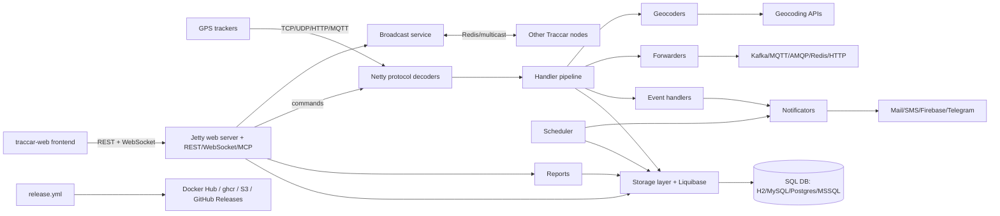

# Harness assessment: Traccar (tracker-server)

Written by uw-harness 0.3.0 (spec v4) on 2026-11-01. It records what the repository showed before the harness was built. Do not edit it by hand: run `npx uw-harness analyze --force` to refresh it.

**Score before:** 30/100, level 0.

## The product

Open source GPS tracking server in Java that decodes 200+ device protocols, stores positions in an SQL database and exposes a REST/WebSocket API for the Traccar web and mobile apps.

Traccar lets anyone track vehicles, assets or people with almost any GPS tracker on the market, without vendor lock-in. One self-hosted (or managed) server receives data from 2000+ device models, keeps the history in a standard SQL database, and gives users live maps, reports, geofences, alarms and notifications through a REST API and the web dashboard.

**Users:** Fleet operators and dispatchers who follow vehicles in real time and read reports, GPS tracking resellers who run a white-label Traccar platform for their customers, Individuals who track their own devices, Administrators who self-host and configure the server (traccar.xml, database, protocols), Integrators who consume the REST API, WebSocket stream, MCP endpoint or event forwarders (Kafka, MQTT, AMQP, Redis, HTTP)

### Use cases

- **Receive and decode device data.** Trackers connect over TCP/UDP/HTTP/MQTT on per-protocol ports; a Netty pipeline frames and decodes the binary or text messages into Position objects. Entry points: `src/main/java/org/traccar/ServerManager.java`, `src/main/java/org/traccar/TrackerServer.java`, `src/main/java/org/traccar/BasePipelineFactory.java`, `src/main/java/org/traccar/protocol/*ProtocolDecoder.java (e.g. Gt06ProtocolDecoder.java)`.
- **Process and store positions.** Decoded positions go through a handler chain (filter, time, distance, motion, engine hours, geocoding, geofences, speed limits, computed attributes) and are written to the database, sometimes in batches. Entry points: `src/main/java/org/traccar/ProcessingHandler.java`, `src/main/java/org/traccar/handler/`, `src/main/java/org/traccar/database/PositionBatchWriter.java`, `src/main/java/org/traccar/storage/DatabaseStorage.java`.
- **Generate events and send notifications.** Event handlers detect alarms, geofence enter/exit, overspeed, ignition, maintenance and more; notificators send them by email, SMS, Firebase push, Telegram, Pushover, WhatsApp or web. Entry points: `src/main/java/org/traccar/handler/events/`, `src/main/java/org/traccar/notification/`, `src/main/java/org/traccar/notificators/`, `templates/notifications/`.
- **Manage accounts, devices and permissions via REST API.** Jersey resources under /api manage users, devices, groups, drivers, geofences, calendars, attributes, maintenance, notifications, permissions, sessions and shares; documented in openapi.yaml. Entry points: `src/main/java/org/traccar/api/resource/`, `src/main/java/org/traccar/api/security/`, `openapi.yaml`, `src/main/java/org/traccar/web/WebServer.java`.
- **Live tracking in the web dashboard.** Jetty serves the traccar-web frontend and a WebSocket that pushes live positions, events and device status. Entry points: `src/main/java/org/traccar/api/AsyncSocket.java`, `src/main/java/org/traccar/api/AsyncSocketServlet.java`, `src/main/java/org/traccar/session/ConnectionManager.java`, `traccar-web (git submodule, empty in this checkout)`.
- **Reports and exports.** Route, events, trips, stops, summary, geofence and combined reports, with Excel (jxls templates), CSV, GPX and KML export, and scheduled reports by email. Entry points: `src/main/java/org/traccar/api/resource/ReportResource.java`, `src/main/java/org/traccar/reports/`, `templates/export/`, `src/main/java/org/traccar/schedule/TaskReports.java`.
- **Send commands to devices.** Users send commands (engine stop, reboot, custom) that protocol encoders translate to device-specific messages, queued when the device is offline. Entry points: `src/main/java/org/traccar/api/resource/CommandResource.java`, `src/main/java/org/traccar/database/CommandsManager.java`, `src/main/java/org/traccar/protocol/*ProtocolEncoder.java`.
- **Forward data to other systems.** Positions and events are forwarded to Kafka, MQTT, AMQP, Redis, Wialon or HTTP URLs. Entry points: `src/main/java/org/traccar/forward/`, `src/main/java/org/traccar/handler/PositionForwardingHandler.java`.
- **Authentication and single sign-on.** Login with password, TOTP, LDAP or OpenID Connect; OAuth clients; MCP endpoint for AI tools. Entry points: `src/main/java/org/traccar/api/resource/SessionResource.java`, `src/main/java/org/traccar/api/resource/OidcResource.java`, `src/main/java/org/traccar/database/LdapProvider.java`, `src/main/java/org/traccar/database/OpenIdProvider.java`, `src/main/java/org/traccar/web/McpServerHolder.java`.
- **Background jobs and health.** Scheduled tasks for device inactivity, expirations, session timeout, cleanup of temporary data, health check and WebSocket keepalive; /api/health endpoint. Entry points: `src/main/java/org/traccar/schedule/ScheduleManager.java`, `src/main/java/org/traccar/api/resource/HealthResource.java`.

### Glossary

| Term | Meaning |
| --- | --- |
| Position | One decoded location fix from a device (time, coordinates, speed, course, plus free-form attributes). Model in org.traccar.model.Position. |
| Device | A tracker identified by its uniqueId (usually IMEI). |
| Protocol decoder / encoder | Per-protocol Netty handler that turns raw device bytes into Positions (decoder) or commands into device bytes (encoder). Around 680 files in org.traccar.protocol. |
| Frame decoder | Netty handler that splits the byte stream into complete device messages before the protocol decoder. |
| Handler | Processing step applied to every Position after decoding (org.traccar.handler), e.g. FilterHandler, GeofenceHandler. |
| Event | Something derived from positions (alarm, geofence enter/exit, overspeed, ignition on/off, device online/offline). |
| Notificator | Delivery channel for event notifications (mail, SMS, Firebase, Telegram, Pushover, WhatsApp, web, command). |
| Forwarder | Component that sends positions or events to an external system (Kafka, MQTT, AMQP, Redis, URL, Wialon). |
| Computed attribute | User-defined JEXL expression evaluated on each position to create derived attributes. |
| Geofence | Geographic area (circle, polygon, polyline) that triggers enter/exit events. |
| Server (model) | The single global settings record of the instance, not a host. |
| Keys | org.traccar.config.Keys: the documented catalogue of every configuration key in traccar.xml. |
| debug.xml / traccar.xml | Java properties XML configuration files; debug.xml is the local development config used by default by Main, setup/traccar.xml is the packaged default. |
| Broadcast service | Cluster synchronisation of cache updates between several Traccar nodes via Redis or multicast. |
| Plus codes | Open Location Code offline geocoder used in debug.xml (geocoder.type=pluscodes). |
| MCP | Model Context Protocol endpoint exposing the API to AI tools (web.mcp.enable). |

## Stack

- Languages: Java 21 (build target; release builds use JDK 25), Python 3 (tools/ scripts for integration and performance testing), Shell
- Frameworks: Gradle 9.8.2 (wrapper), Netty 4.2 (device networking), Jetty 12.1 + Jersey 4 (HTTP, REST, WebSocket), Guice 7 (dependency injection), Jackson, Liquibase 5 (schema migrations, schema/changelog-*.xml), HikariCP, jxls / Apache POI and Velocity (reports and notification templates), JUnit Jupiter 6 + Mockito 5, Checkstyle 14.4 (gradle/checkstyle.xml), Protocol Buffers
- Data stores: H2 (default, embedded file database), MySQL / MariaDB, PostgreSQL / TimescaleDB (docker/compose/traccar-timescaledb.yaml), Microsoft SQL Server, Redis (optional broadcast and forwarding)
- External services: Geocoding providers (Google, Nominatim, Here, Mapbox, OpenCage, etc. in org.traccar.geocoder), Geolocation providers (org.traccar.geolocation), AWS SNS (SMS), Firebase Cloud Messaging, Telegram, Pushover, WhatsApp, SMTP mail, Kafka, MQTT (HiveMQ), RabbitMQ AMQP, LDAP and OpenID Connect providers, Azure Identity (SQL Server auth), Docker Hub and ghcr.io (release images), DigitalOcean Spaces S3 (preview builds) and GitHub Releases

## Architecture

| Component | Kind | Path | Tech | What it does |
| --- | --- | --- | --- | --- |
| Tracker server (protocol layer) | service | `src/main/java/org/traccar/ (ServerManager.java, TrackerServer.java, BasePipelineFactory.java, protocol/)` | Java 21, Netty | Opens one TCP/UDP/HTTP/MQTT listener per enabled protocol, frames and decodes device messages into Positions, encodes commands back to devices. |
| Processing pipeline | library | `src/main/java/org/traccar/handler/, ProcessingHandler.java` | Java, Guice | Chain of position handlers and event handlers (filter, geocoder, geofence, motion, speed limit, computed attributes, alarms). |
| Web server and REST API | api | `src/main/java/org/traccar/web/, src/main/java/org/traccar/api/` | Jetty 12, Jersey 4, Jackson | Serves /api REST resources (openapi.yaml), WebSocket live updates, the MCP endpoint, the static web app and an optional H2 console. |
| Web frontend | frontend | `traccar-web (git submodule, not checked out)` | Separate repository traccar/traccar-web, built with npm in release.yml | Browser dashboard served by the web server from web.path. |
| Storage layer | library | `src/main/java/org/traccar/storage/, schema/` | JDBC, HikariCP, Liquibase | DatabaseStorage builds SQL queries for model objects; Liquibase changelogs in schema/ migrate the tc_* tables at startup. MemoryStorage for in-memory mode. |
| SQL database | database | `configured in debug.xml / traccar.xml` | H2 by default; MySQL, MariaDB, PostgreSQL, SQL Server | Stores users, devices, positions, events, geofences, settings. |
| Scheduler | scheduler | `src/main/java/org/traccar/schedule/` | Java executor | Periodic tasks: inactivity checks, expirations, scheduled reports, cleanup, health check, keepalive. |
| Notifications | service | `src/main/java/org/traccar/notification/, notificators/, templates/notifications/` | Velocity, Jakarta Mail, AWS SNS, Firebase | Formats and sends event notifications through several channels. |
| Forwarders | integration | `src/main/java/org/traccar/forward/` | Kafka, MQTT, AMQP, Redis, HTTP | Push positions and events to external systems. |
| Reports | library | `src/main/java/org/traccar/reports/, templates/export/` | jxls, POI | Report providers and file exports (xlsx, CSV, GPX, KML). |
| Broadcast service | integration | `src/main/java/org/traccar/broadcast/` | Redis or UDP multicast | Keeps caches consistent between clustered instances. |
| Geocoder / geolocation | integration | `src/main/java/org/traccar/geocoder/, geolocation/` | HTTP clients | Reverse geocoding and cell/wifi geolocation through external providers. |
| Packaging and release | ci | `.github/workflows/release.yml, setup/, docker/` | GitHub Actions, makeself, Inno Setup, jlink, Docker | Builds Linux/Windows installers and Alpine/Debian/Ubuntu Docker images, smoke tests them, publishes to S3, GitHub Releases, Docker Hub and ghcr.io. |
| Dev tools | tooling | `tools/` | Python 3, shell | Integration test that sends sample messages to a running server, performance, command and trip test scripts, config doc generator. |

## Workflows found in the repository

- setup: `./gradlew assemble`
- run local: `java -jar target/tracker-server.jar debug.xml`
- test: `./gradlew test`
- lint: `./gradlew checkstyleMain checkstyleTest`
- build: `./gradlew build`
- deploy: not found

## Requirements

### ✗ An AGENTS.md at the root

`agents-file`, level 1. Check: no AGENTS.md.

**Gap.** There is no agent entry file.

**Plan.** Create AGENTS.md (under 150 lines): what Traccar is, commands (./gradlew assemble, ./gradlew test, ./gradlew check, ./gradlew build, java -jar target/tracker-server.jar debug.xml, ./gradlew test --tests org.traccar.protocol.Gt06ProtocolDecoderTest), layout (src/main/java/org/traccar/{protocol,handler,api,web,storage,schedule,notificators,forward,reports}, schema/, templates/, setup/, docker/, tools/, traccar-web submodule), conventions (Checkstyle, one decoder + one *ProtocolDecoderTest per protocol, Liquibase changelog for schema changes, new config keys in config/Keys.java), what never to do, links to docs/. Create CLAUDE.md containing only `@AGENTS.md`.

Reference: https://docs.unwritten.sh/harness/requirements/agents-file/

### ✗ AGENTS.md matches the repository

`agents-file-accurate`, level 1. Check: no AGENTS.md to check.

**Gap.** Nothing to verify yet.

**Plan.** Only cite ./gradlew tasks that exist (build, test, check, assemble, clean, copyDependencies, checkstyleMain, checkstyleTest) and relative links to files created in the same change (docs/architecture.md, docs/product.md, docs/local-dev.md, docs/deploy.md, docs/observability.md, CONTRIBUTING.md). Run uw-harness check.

Reference: https://docs.unwritten.sh/harness/requirements/agents-file-accurate/

### ✗ An architecture overview with a diagram

`architecture`, level 1. Check: no docs/architecture.md.

**Gap.** No architecture document.

**Plan.** Create docs/architecture.md with the Mermaid diagram from this assessment, then sections: startup (Main.java: Guice MainModule, DatabaseModule, WebModule; services ScheduleManager, ServerManager, WebServer, BroadcastService), protocol layer, handler pipeline, storage and Liquibase schema/ (tc_* tables), web/API, scheduler, notifications, forwarders, broadcast, frontend submodule. State that production hosting is not visible in the repository.

Reference: https://docs.unwritten.sh/harness/requirements/architecture/

### ◐ What the product does and for whom

`product`, level 1. Check: only README.md (62 lines), no docs/product.md.

**Gap.** Value proposition exists in README but there is no product doc tied to code entry points.

**Plan.** Create docs/product.md with value proposition, user roles, the use cases and entry points listed in this assessment, and the glossary.

Reference: https://docs.unwritten.sh/harness/requirements/product/

### ✗ Architecture decision records

`decisions`, level 2. Check: no docs/decisions/.

**Gap.** No decision records.

**Plan.** Create docs/decisions/0001-record-architecture-decisions.md (format) and 0002-netty-protocol-decoders-per-device.md or 0002-multi-database-with-liquibase.md, marked 'Inferred from the code, to be confirmed by the team.'

Reference: https://docs.unwritten.sh/harness/requirements/decisions/

### ✗ An implementation log

`implementation-log`, level 2. Check: no docs/harness/log.md.

**Gap.** No implementation log.

**Plan.** Create docs/harness/log.md with a first dated entry (2026-11-01) and tell agents in AGENTS.md to append one entry per significant change.

Reference: https://docs.unwritten.sh/harness/requirements/implementation-log/

### ✗ Team agreements

`agreements`, level 1. Check: no CONTRIBUTING.md or docs/agreements/.

**Gap.** Team rules are not written down.

**Plan.** Create CONTRIBUTING.md: commit style seen in history (imperative, capitalised, no prefix, '(#PR)' and '(fix #issue)'), PRs against master, Checkstyle must pass, protocol changes need a decoder test with a real sample message, schema changes need a new schema/changelog-<version>.xml included from changelog-master.xml. Definition of done: ./gradlew build green. Mark inferred rules as inferred.

Reference: https://docs.unwritten.sh/harness/requirements/agreements/

### ✓ One entry point for tasks

`task-runner`, level 1. Check: build.gradle: 6 tasks.

### ◐ A fast gate

`fast-gate`, level 2. Check: fast gate "test" exists but was never verified (run uw-harness verify).

**Gap.** ./gradlew test exists but has never been verified by uw-harness verify.

**Plan.** Use ./gradlew test as the fast gate; run uw-harness verify. If a test fails, mark it @Disabled with the reason and log it in docs/harness/log.md.

Reference: https://docs.unwritten.sh/harness/requirements/fast-gate/

### ◐ A full gate

`full-gate`, level 2. Check: full gate "check" exists but was never verified (run uw-harness verify).

**Gap.** ./gradlew check exists but has never been verified.

**Plan.** Use ./gradlew check (or ./gradlew build, which CI runs) as the full gate and run uw-harness verify.

Reference: https://docs.unwritten.sh/harness/requirements/full-gate/

### ✓ Automated tests

`tests`, level 1. Check: 426 test files (ignored: 4 with only trivial assertions).

### ✓ CI runs the gate on every change

`ci`, level 2. Check: CI calls 2 task runner targets (build, assemble).

### ✗ Git hooks run the fast gate

`hooks`, level 3. Check: no git hooks configuration.

**Gap.** No local git hook.

**Plan.** Add .githooks/pre-push running `./gradlew test checkstyleMain checkstyleTest` and document `git config core.hooksPath .githooks` in AGENTS.md and docs/local-dev.md (Gradle has no setup target to install it automatically).

Reference: https://docs.unwritten.sh/harness/requirements/hooks/

### ✗ The app runs locally with one command

`local-env`, level 1. Check: no compose file, devcontainer or dev target.

**Gap.** The checker found no root compose file and no dev/run target; local run is a manual java -jar command.

**Plan.** Add a Gradle JavaExec task named `run` (mainClass org.traccar.Main, args debug.xml, dependsOn classes) in build.gradle without changing existing tasks; add a root compose.yaml with an optional MySQL or PostgreSQL service for testing other databases; write docs/local-dev.md (JDK 21, ./gradlew assemble, run with debug.xml, web UI on :8082 needs the traccar-web submodule, reset by deleting target/database*, logs on console, H2 console at /console).

Reference: https://docs.unwritten.sh/harness/requirements/local-env/

### ✗ Configuration is documented, no secret in git

`env-example`, level 1. Check: no .env.example.

**Gap.** No .env.example documenting environment-variable configuration.

**Plan.** Create .env.example with CONFIG_USE_ENVIRONMENT_VARIABLES=true, DATABASE_DRIVER=org.h2.Driver, DATABASE_URL=jdbc:h2:./target/database, DATABASE_USER=sa, DATABASE_PASSWORD= and a comment that any key in config/Keys.java maps to an upper-case env variable. Main configuration stays in debug.xml/traccar.xml.

Reference: https://docs.unwritten.sh/harness/requirements/env-example/

### ✗ Toolchain versions are pinned

`toolchain-pinned`, level 1. Check: no runtime version file.

**Gap.** Java version is set in build.gradle but no version file the checker recognises.

**Plan.** Add .java-version containing 21 (or a .sdkmanrc with java=21-tem) to match CI. Optionally add a Gradle java toolchain block; ask the team whether 21 or 25 is preferred.

Reference: https://docs.unwritten.sh/harness/requirements/toolchain-pinned/

### ◐ Deployment is explicit in the repository

`deploy-explicit`, level 3. Check: deployment artifacts (docker/Dockerfile.alpine, docker/Dockerfile.debian, docker/Dockerfile.ubuntu) but no docs/deploy.md.

**Gap.** Release artifacts and pipeline exist but are not documented; how the managed hosting is deployed is not visible.

**Plan.** Write docs/deploy.md: environments (self-host installers, Docker images, managed hosting = TODO), how a release is built (bump Implementation-Version in build.gradle, schema changelog, run Build Release with a version input), what is published where, smoke test in the workflow, rollback (TODO), who can deploy (TODO). Use uw-harness TODO blocks for unknowns.

Reference: https://docs.unwritten.sh/harness/requirements/deploy-explicit/

### ✗ Production can be observed

`observability`, level 3. Check: no docs/observability.md.

**Gap.** No observability doc; where production logs and alerts live is not visible.

**Plan.** Write docs/observability.md: logging config and default logs/ folder, /api/health semantics (web.healthCheck.dropThreshold), statistics API, TaskHealthCheck, web request log; TODO blocks for log storage, dashboards and alert channel of the managed service.

Reference: https://docs.unwritten.sh/harness/requirements/observability/

### ✗ Skills for repeated tasks

`skills`, level 2. Check: no skills in .agents/skills/ or .claude/skills/.

**Gap.** No skills.

**Plan.** Create .agents/skills/implement-change, add-protocol-decoder (decoder + frame decoder + registration + *ProtocolDecoderTest with hex samples, run single test), debug-local (run with debug.xml, logger.fullStackTraces, H2 console, tools/test-integration.py / hex.sh to send sample messages), add-schema-change (new Liquibase changelog), and release (pointing to docs/deploy.md and its TODOs). Symlink .claude/skills to .agents/skills.

Reference: https://docs.unwritten.sh/harness/requirements/skills/

## Questions for a human

- (`deploy-explicit`) How is the managed hosting (traccar.org pricing) and the demo server deployed and updated: from the Docker images, installers, or another pipeline outside this repository? release.yml only publishes artifacts; production rollout is not visible.
- (`deploy-explicit`) Who is allowed to run the 'Build Release' workflow, and how is a bad release rolled back (re-tag, previous Docker tag, schema rollback)? Needed for the deploy doc and the release skill; Liquibase migrations make rollback non-trivial.
- (`observability`) For the managed service, where are logs, metrics and alerts kept, and which signal tells you production is broken (only /api/health, or something else)? The code shows logging and a health endpoint but no external monitoring.
- (`agreements`) Should outside contributors and agents always open a pull request, while maintainers keep committing directly to master as the history shows? Defines the branch rule written into CONTRIBUTING.md and AGENTS.md.
- (`agreements`) What is the definition of done for a protocol change: is a decoder test with a real device sample always required, and must tools/test-integration.py also pass? Most changes are protocol decoders; the rule decides what agents must verify.
- (`toolchain-pinned`) Which Java version should developers use: 21 (CI and build.gradle) or 25 (release builds and Docker images)? The version file must match the intended toolchain.
- (`local-env`) Should local development check out the traccar-web submodule (relative URL ../traccar-web.git), or is the backend usually run without the web UI? debug.xml points web.path to ./traccar-web/simple, which is empty in this checkout.

## Risks

- build.gradle resolves Jersey transitive versions at configuration time (resolveTransitiveVersion), so every Gradle invocation, even listing tasks, needs network access to Maven Central.
- ./gradlew test runs about 426 test classes; it may take minutes, which is slow for a 'fast' gate and a pre-push hook.
- Checkstyle is part of ./gradlew check and build: any style violation fails CI, so agents must follow gradle/checkstyle.xml.
- The traccar-web submodule uses a relative URL (../traccar-web.git) and is empty here; cloning it fails outside GitHub and the web UI will not load locally.
- Java version mismatch: CI builds on Java 21 while release and Docker images use JDK 25.
- Schema changes need Liquibase changelogs that work on H2, MySQL, PostgreSQL and SQL Server; unit tests run against H2/memory only, so cross-database breakage is not caught.
- tools/test-integration.py and other Python tools need a running server and are not run by CI; they can rot without notice.
- docker/compose/*.yaml contain demo database password 'traccar'; a secret scanner may flag them (they are examples, not real secrets).
- Many commits go straight to master; a harness that assumes PR review may not match current practice.
- The protocol package is very large (about 680 files); agents may duplicate helpers instead of reusing BaseProtocolDecoder, Parser, BitUtil and similar helpers.
